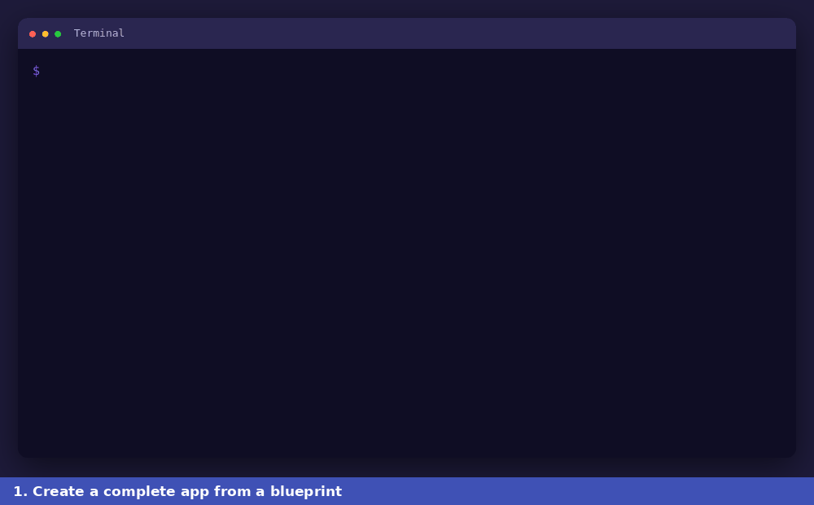

<div align="center">

# AI App Server

### Ship AI apps, not infrastructure.

Chat over your documents, document extraction, agents and approval workflows, from **one small config file**.<br>
Vector search, memory, jobs, a model gateway, guardrails, sign-in and audit are already inside.

[](https://github.com/Sandaal/ai-app-server/releases/latest)
[](https://sandaal.github.io/ai-app-server/)
[](https://sandaal.github.io/ai-app-server/install/)
[](LICENSE)

**[Documentation](https://sandaal.github.io/ai-app-server/)** · **[Quickstart](https://sandaal.github.io/ai-app-server/get-started/quickstart/)** · **[Download](https://github.com/Sandaal/ai-app-server/releases/latest)** · **[Project status](https://sandaal.github.io/ai-app-server/status/)**

</div>

---

<p align="center"></p>
<p align="center"><sub>A real run: a local model on CPU via Ollama, with waits shortened. · <a href="https://sandaal.github.io/ai-app-server/videos/">Walkthrough videos</a> (3 to 5 minutes each)</sub></p>

```bash
aiapp new knowledge-chat hr-bot --provider openai   # a complete app, ready to run
cd hr-bot && aiapp source add ./policies/            # your documents
aiapp deploy                                         # live: chat with citations at /apps/hr-bot/
```

## Why AI App Server?

An AI demo takes a day. The production app takes months, because the model call is the easy part. Around it you need a vector database and ingestion pipeline, memory and a cache, a job queue, a gateway across model providers, guardrails, sign-in and audit, and deploys, monitoring and backups. That's **eight systems** to choose, secure, pay for and run, for every app.

**AI App Server is all of them in one ~20 MB download.**

| You need | The usual way | With AI App Server |
|---|---|---|
| Search over documents | Vector DB + ingestion pipeline | ✅ Built in: hybrid search, PDF/Office/web documents, SharePoint, Git, S3… |
| Memory and cache | Redis | ✅ Built in, and Redis clients still work |
| Jobs and events | Celery, Kafka | ✅ Built in, with retries, dead letters and Kafka bridges |
| Many model providers | An AI gateway | ✅ OpenAI, Azure OpenAI, Anthropic, Gemini, Bedrock, local models |
| Safety | Custom filters | ✅ PII redaction, prompt-injection and citation checks |
| Security sign-off | Weeks of work | ✅ Entra ID / OIDC, roles, encrypted storage, SIEM-ready audit log |
| Shipping changes | CI scripts per app | ✅ `aiapp deploy`, versions, one-command rollback |

You write only what makes your app different: settings, plus Python or JavaScript handlers when you need them.

## Ten apps, ready to deploy

| | | |
|---|---|---|
| 📚 **Knowledge chat**: answers from your documents, with citations | 🎧 **Customer support**: calls your tools, asks before refunds | 🧾 **Document extraction**: invoices and forms to JSON |
| 📝 **Summarization**: long documents to key points | 🏷️ **Classification**: route tickets and emails | 🎙️ **Meeting notes**: decisions and action owners |
| ✍️ **Content review**: drafts with human approval | 📊 **Data insights**: questions over SQL and CSV | 💻 **Code assistant**: answers citing files and lines |
| 🤖 **Workflow agent**: tools and MCP, with approvals | | |

Complete, tested source for each one is in [`apps/`](apps/). Copy one, change it, and deploy it.

## Built for production

- 🔒 **Secure by default:** encrypted storage, API keys with roles, Entra ID and OIDC sign-in, tenant isolation, audit export to your SIEM.
- 💰 **Costs under control:** token and cost budgets per app and per key, routing to the cheapest model that meets a latency target, fallbacks across providers.
- 🧱 **Isolated apps:** one misbehaving app can't exhaust another's memory, disk, budget or workers.
- 📈 **Observable:** traces of every request, model call and tool, Prometheus and OpenTelemetry metrics, and a web console.
- 🏠 **Runs where your data is:** a laptop, your servers, Kubernetes, Azure, or a fully offline network, with local models through llama.cpp and Ollama.
- 🌐 **Scales out:** clusters where every node serves and data is replicated across nodes.

## Install

**Windows** (PowerShell):

```powershell
irm https://github.com/Sandaal/ai-app-server/releases/latest/download/install.ps1 -OutFile install.ps1
powershell -ExecutionPolicy Bypass -File install.ps1
```

**macOS / Linux:**

```bash
curl -fsSLO https://github.com/Sandaal/ai-app-server/releases/latest/download/install.sh
sh install.sh
```

**Docker:**

```bash
docker run -d -p 8080:8080 -v aiapp-data:/data -e OPENAI_API_KEY=sk-... ghcr.io/sandaal/aiapp-server:latest
```

Kubernetes (Helm) and Azure (`azd`) templates are in [`deploy/`](deploy/). The VS Code extension is in each [release](https://github.com/Sandaal/ai-app-server/releases/latest) and on [Open VSX](https://open-vsx.org/extension/sandaal/aiapp-vscode).

**Next:** the [10-minute quickstart](https://sandaal.github.io/ai-app-server/get-started/quickstart/).

## Project status and help wanted

**v3.0** is the current release. The single-server platform, the ten blueprints, local models on CPU and clusters are tested on real systems. The newest features, for GPUs, BlueField DPUs, CXL memory and SEV-SNP/TDX confidential VMs, are **in preview**: built, but tested only on emulated hardware so far. Hosted model providers and Azure services are tested against fakes of their APIs. **[Project status](https://sandaal.github.io/ai-app-server/status/)** lists exactly what was tested how.

🙌 **Have that hardware, or cloud credits?** [Open a hardware offer](https://github.com/Sandaal/ai-app-server/issues/new?template=hardware-offer.yml). Remote access for a few days helps verify a feature for everyone.

## What's in this repository

| Folder | What it holds |
|---|---|
| [`apps/`](apps/) | Complete, tested apps for ten use cases, and examples of every extension point |
| [`sdk/`](sdk/) | Source of the Python SDK (including how each blueprint works) and the JavaScript client and web components |
| [`deploy/`](deploy/) | Helm chart, Azure (`azd`) templates and a systemd unit |
| [`schema/`](schema/) | JSON Schema for `ai-app.yaml`, for editor checks |
| [`docs/`](docs/) | Source of the [documentation site](https://sandaal.github.io/ai-app-server/) |

The server itself is distributed as binaries and a Docker image, and is free to use. The SDKs, example apps and templates here are licensed under the [Apache License 2.0](LICENSE). Questions and bug reports are welcome as [issues](https://github.com/Sandaal/ai-app-server/issues); for security issues see [SECURITY.md](SECURITY.md).
