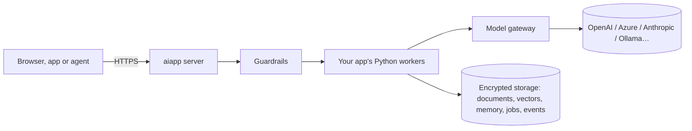

# How it works

**One program.** `aiapp serve` runs the server. Every other command (`aiapp new`, `aiapp deploy`, `aiapp logs`…) talks to the running server on the same machine.

**An app is a folder.** It holds an `ai-app.yaml` file and, if you want, Python files, documents and tests. `aiapp deploy` turns the folder into a running app at `http://SERVER:8080/apps/APP-NAME/`.

**Blueprints are ready-made apps.** `aiapp new knowledge-chat hr-bot` creates a complete, working app that you deploy straight away and then adjust. There are [ten blueprints](../build/blueprints.md).

**Everything lives on the server, encrypted.** Documents, the search index, conversation memory, background jobs, events and the audit log are stored in the server's data folder (`~/.aiapp` by default), encrypted with a master key.

**Models go through a gateway.** Calls to OpenAI, Azure OpenAI, Anthropic, Gemini, Bedrock or a local model pass through the server, which counts tokens and cost, enforces budgets, caches, retries and fails over between deployments.

## Words used in these docs

| Word | Meaning |
|---|---|
| **App** | A folder with `ai-app.yaml`, deployed to the server. Reached at `/apps/NAME/`. |
| **Route** | A URL of the app, such as `/chat`, handled by a blueprint or by your Python function. |
| **Handler** | A Python function that answers a route, a job or an event. |
| **Source** | Documents the app answers from: a folder, or a connector (Git, SharePoint…). |
| **Worker** | A Python process running an app's handlers. The server starts, watches and restarts them. |
| **Version** | Every deploy is a new, immutable version; you can roll back to any of them. |
| **Guardrail** | A check on requests or answers: redact personal data, block topics, require citations… |
| **Data folder** | Where the server keeps everything (`~/.aiapp`). Contains the master key: protect and back it up. |
