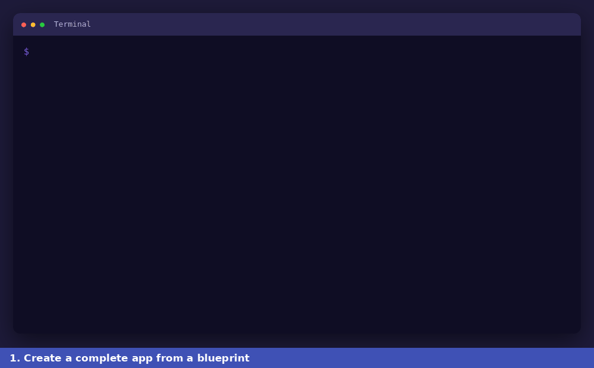

<div class="hero" markdown>

<p class="hero-eyebrow">Free to use · v3.0 · Windows, macOS, Linux, Docker, Kubernetes</p>

# Ship AI apps, <br>not infrastructure.

<p class="hero-lead">AI App Server runs chat over your documents, extraction, agents and approval workflows from <strong>one small config file</strong>. The web service, vector search, memory, job queue, model gateway, guardrails and audit log are already inside. One download, about 20 MB.</p>

[Get started in 10 minutes](get-started/quickstart.md){ .md-button .md-button--primary }
[Download v3.0](download.md){ .md-button }
[See it on GitHub](https://github.com/Sandaal/ai-app-server){ .md-button }

</div>

<div class="hero-code" markdown>

```bash
aiapp new knowledge-chat hr-bot --provider openai   # a complete app, ready to run
cd hr-bot && aiapp source add ./policies/            # your documents
aiapp deploy                                         # live at /apps/hr-bot/: chat with citations
```

</div>

<figure class="demo" markdown>

<figcaption>A real run: a local model on CPU via Ollama, with waits shortened. <a href="videos/">Watch the four walkthrough videos</a> (3 to 5 minutes each).</figcaption>
</figure>

## The problem: an AI demo takes a day, the production app takes months

The model call is the easy part. Before an AI app can serve real users, someone has to build and run everything around it:

<div class="grid cards pain" markdown>

-   :material-database-cog: **A vector database**, plus the chunking, embedding and re-indexing pipeline that feeds it
-   :material-message-text-clock: **Conversation memory** and a cache, usually Redis
-   :material-tray-full: **A job queue** for long documents and agent runs, often with Kafka
-   :material-swap-horizontal: **A model gateway** for retries, fallbacks, budgets and cost tracking across providers
-   :material-shield-alert: **Guardrails** for personal data, prompt injection and unsupported answers
-   :material-account-key: **Sign-in, roles, audit and secrets** before security will approve it
-   :material-rocket-launch: **Deploys, rollback, monitoring and backups** for every app
-   :material-puzzle: **Glue code** to hold it all together, rewritten for every new app

</div>

That is eight systems to choose, secure, pay for and keep running, before the first user asks a question.

## The answer: one server that already has all of it

<div class="compare" markdown>

| You need | The usual way | With AI App Server |
|---|---|---|
| Search over documents | Vector DB + ingestion pipeline | **Built in:** hybrid vector and keyword search over PDF, Office and web documents, plus connectors |
| Memory and cache | Redis | **Built in,** and Redis clients still work |
| Jobs and events | Celery, Kafka | **Built in,** with retries, dead letters and Kafka bridges |
| Many model providers | An AI gateway | **Built in:** OpenAI, Azure, Anthropic, Gemini, Bedrock, local models |
| Safety | Custom filters | **Built in:** PII redaction, injection checks, citation checks |
| Security sign-off | Weeks of work | **Built in:** Entra ID / OIDC, roles, encrypted storage, audit export |
| Shipping changes | CI scripts per app | `aiapp deploy`, with versions and one-command rollback |

</div>

You write only what makes your app different: a few settings, and Python or JavaScript handlers when you need them.

## From folder to live app in three steps

<div class="grid cards steps" markdown>

-   <span class="step">1</span> **Pick a blueprint**

    ---

    `aiapp new knowledge-chat hr-bot` creates a complete, working app: settings, page and tests.

-   <span class="step">2</span> **Add your documents and model**

    ---

    Point it at a folder, SharePoint, Git or a website. Choose any model provider, or a local model.

-   <span class="step">3</span> **Deploy**

    ---

    `aiapp deploy`. Your app is live with a web page, an API and its own quotas, and can be published to AI agents over MCP.

</div>

## Ten ready-made apps for the most common AI use cases

Start from a blueprint that already works, and change only what you need.

<div class="grid cards blueprints" markdown>

-   :material-book-open-variant: **Knowledge chat**

    Answers from your documents, with citations

-   :material-face-agent: **Customer support**

    Calls your tools, asks a person before refunds

-   :material-file-document-check: **Document extraction**

    Invoices and forms to JSON, with page evidence

-   :material-text-box-search: **Summarization**

    Long documents to key points

-   :material-tag-multiple: **Classification**

    Route tickets and emails to your labels

-   :material-microphone-message: **Meeting notes**

    Recordings to decisions and owners

-   :material-pencil-box-multiple: **Content review**

    Drafts with human review and revisions

-   :material-chart-box: **Data insights**

    Questions over SQL and CSV, queries shown

-   :material-code-braces: **Code assistant**

    Answers about a codebase, citing files and lines

-   :material-robot: **Workflow agent**

    Tools and MCP servers, with approvals

</div>

[Explore the blueprints](build/blueprints.md){ .md-button }

## Built for production from day one

<div class="grid cards" markdown>

-   :material-lock: **Secure by default**

    ---

    Everything on disk is encrypted. API keys with roles, Entra ID and any OIDC sign-in, per-tenant isolation, and an audit log you can stream to your SIEM.

-   :material-shield-check: **Safe answers**

    ---

    Redact personal data before it reaches a model, block prompt injection and banned topics, and withhold answers the documents don't support.

-   :material-cash-lock: **Costs under control**

    ---

    Token and cost budgets per app and per key. Route each request to the cheapest model that meets its latency target, and fall back across providers.

-   :material-chart-timeline-variant: **Observable**

    ---

    Traces of every request, model call and tool, plus Prometheus and OpenTelemetry metrics and a web console.

-   :material-backup-restore: **Safe to change**

    ---

    Every deploy is a version. Zero-downtime deploys, instant rollback, evaluations before you ship, and encrypted backups.

-   :material-account-group: **Isolated apps**

    ---

    One misbehaving app can't exhaust another's memory, disk, model budget or workers. It runs in separate worker processes under its own quotas.

</div>

## Runs where your data is

<div class="grid cards four" markdown>

-   :material-laptop: **Your laptop**

    ---

    Windows, macOS and Linux. Starts in seconds. VS Code extension included.

-   :material-server: **Your servers**

    ---

    Docker, Kubernetes (Helm), Azure (`azd up`), or a plain Linux service. Fully offline installs for air-gapped networks.

-   :material-chip: **Your models**

    ---

    Hosted providers, or local models through llama.cpp and Ollama, so data never leaves the building. vLLM on GPUs is in preview.

-   :material-server-network: **Your scale**

    ---

    Grow from one server to a cluster where every node serves and data is replicated across nodes.

</div>

## Numbers, not adjectives

<div class="stats" markdown>

<div class="stat" markdown><span class="stat-value">10</span><span class="stat-label">blueprints, each tested end to end with a real local model</span></div>
<div class="stat" markdown><span class="stat-value">~40 MB</span><span class="stat-label">memory for an idle server</span></div>
<div class="stat" markdown><span class="stat-value">94 req/s</span><span class="stat-label">streamed chat answers on 8 CPUs, with zero errors</span></div>
<div class="stat" markdown><span class="stat-value">0</span><span class="stat-label">acknowledged writes lost when a cluster's leader was killed mid-load</span></div>

</div>

<p class="stats-note">The load test uses a stand-in model with fixed latency, so it measures the server itself: see <a href="operate/sizing/">Performance and sizing</a>. <a href="status/">Project status</a> lists what has been verified on which hardware.</p>

## Who it's for

<div class="grid cards" markdown>

-   :material-application-brackets: **App developers**

    ---

    Get from idea to a working AI app in an afternoon, without assembling a stack first. Python or JavaScript, and your own frameworks if you like.

    [Your first app →](build/first-app.md)

-   :material-domain: **Platform and IT teams**

    ---

    Offer AI apps to the whole organization on one governed platform, with sign-in, audit, quotas and budgets, on your own servers.

    [Operate the server →](operate/index.md)

-   :material-office-building-cog: **Regulated and offline environments**

    ---

    Keep data on-premises with local models and encrypted storage. Confidential computing support is in preview.

    [Security checklist →](operate/security.md)

</div>

## Free, open about its testing, and growing

AI App Server is free to download and use. Its SDKs, example apps and deployment templates are open source under the Apache 2.0 license. The single-server platform is tested on real systems. The newest features, for GPUs, DPUs, CXL memory and confidential VMs, are **in preview**: they are built, but so far tested only on emulated hardware. We say exactly what has been tested on which hardware, and we're looking for partners with that hardware.

[Project status and help wanted](status.md){ .md-button .md-button--primary }
[Offer hardware access](https://github.com/Sandaal/ai-app-server/issues/new?template=hardware-offer.yml){ .md-button }

<div class="cta" markdown>

## Your first AI app is ten minutes away

[Start the quickstart](get-started/quickstart.md){ .md-button .md-button--primary }
[Browse example apps](build/examples.md){ .md-button }

</div>
